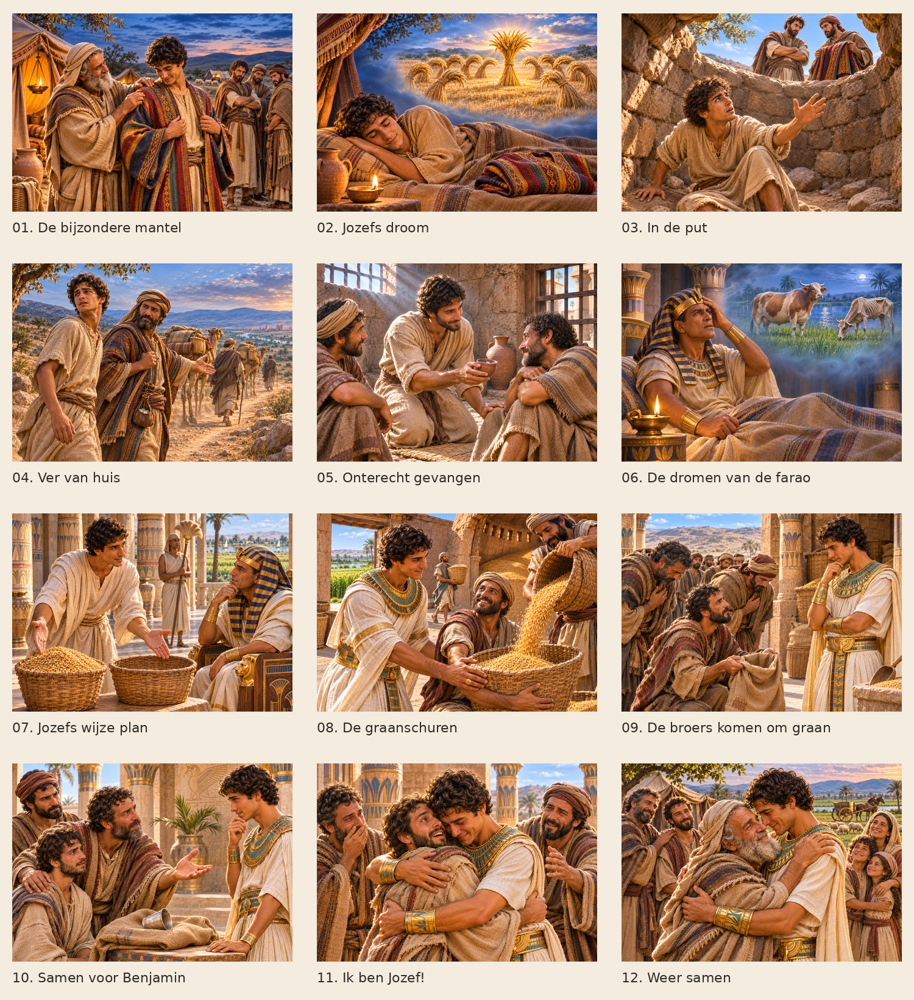

# Jozef — kamishibai-vertelplaten

Twaalf tekstloze, liggende vertelplaten over Jozef, bedoeld voor een kamishibai-theater en kinderen rond zeven jaar. De beelden hebben een realistische, filmische uitstraling: herkenbare mensen, natuurlijke stoffen, warme belichting en duidelijke emoties.

**[Download de twaalf platen als A3-PDF](drukwerk/jozef-vertelplaten-A3.pdf)** · **[Bekijk het overzicht](drukwerk/overzicht.jpg)** · **[Lees de verteltekst](VERHAAL.md)**



## Inhoud

| Plaat | Hoogtepunt | Bijbelgedeelte |
|---|---|---|
| [01](afbeeldingen/01-de-bijzondere-mantel.png) | De bijzondere mantel | Genesis 37:1–4 |
| [02](afbeeldingen/02-jozefs-droom.png) | Jozefs droom | Genesis 37:5–11 |
| [03](afbeeldingen/03-in-de-put.png) | In de put | Genesis 37:12–24 |
| [04](afbeeldingen/04-ver-van-huis.png) | Ver van huis | Genesis 37:25–36 |
| [05](afbeeldingen/05-onterecht-gevangen.png) | Onterecht gevangen | Genesis 39–40 |
| [06](afbeeldingen/06-de-dromen-van-de-farao.png) | De dromen van de farao | Genesis 41:1–13 |
| [07](afbeeldingen/07-jozefs-wijze-plan.png) | Jozefs wijze plan | Genesis 41:14–46 |
| [08](afbeeldingen/08-de-graanschuren.png) | De graanschuren | Genesis 41:47–57 |
| [09](afbeeldingen/09-de-broers-komen-om-graan.png) | De broers komen om graan | Genesis 42–43 |
| [10](afbeeldingen/10-samen-voor-benjamin.png) | Samen voor Benjamin | Genesis 44 |
| [11](afbeeldingen/11-ik-ben-jozef.png) | ‘Ik ben Jozef!’ | Genesis 45 |
| [12](afbeeldingen/12-weer-samen.png) | Weer samen | Genesis 46:1–30; 47:11–12 |

De reeks is een selectie uit het grotere Jozefverhaal, niet een afbeelding van ieder voorval uit Genesis 37–50. [VERHAAL.md](VERHAAL.md) bevat per plaat een eigen navertelling, een kijkvraag en een overgang naar de volgende plaat. De woorden kunnen vrij worden aangepast aan de groep; het zijn geen letterlijke citaten uit een bepaalde Bijbelvertaling.

## Afdrukken en gebruiken

1. Open [jozef-vertelplaten-A3.pdf](drukwerk/jozef-vertelplaten-A3.pdf). Iedere pagina bevat één volledige plaat; pagina 1 hoort bij plaat 01 enzovoort.
2. Kies **A3, liggend, 100% / werkelijke grootte**. De pagina’s meten exact **420 × 297 mm**. Gebruik randloos afdrukken als je printer dat ondersteunt. Zonder randloos afdrukken kan de printer een witte rand geven of het beeld verkleinen.
3. Maak eerst een proefdruk van een lichte en een donkerdere scène, bijvoorbeeld 01 en 05. Beoordeel die op de afstand waarop de kinderen kijken.
4. Controleer de opening en de sleuf van jouw theater. Sommige kamishibai-theaters vragen een ander kaartformaat dan standaard A3. Pas dan de drukmaat aan of overleg met de drukker.
5. Gebruik bij voorkeur stevig, mat papier of monteer de afdrukken op passend karton. Probeer eerst één kaart om te controleren of dikte en afmetingen door het theater passen. Matte afwerking beperkt spiegeling.
6. Leg de platen op volgorde. Houd de verteltekst los naast of achter het theater. De druk-PDF heeft bewust geen titels, paginanummers of andere tekst over de afbeeldingen.

### Resolutie: papierformaat is niet hetzelfde als beelddetail

De oorspronkelijke PNG’s zijn **1491 × 1055 pixels**. Op volledig A3 is dat ongeveer **90 ppi**. De PDF heeft een exacte A3-paginamaat en gebruikt deze oorspronkelijke pixels; hij voegt geen detail toe. Het zijn dus **geen oorspronkelijke 300-ppi-bestanden**. Voor 300 ppi op A3 zou ongeveer 4961 × 3508 pixels nodig zijn.

Voor vertelplaten die op enige afstand worden bekeken kan deze bronresolutie bruikbaar zijn; beoordeel dat met een proefdruk. Voor zeer scherp drukwerk dat van dichtbij wordt bekeken is een hogere oorspronkelijke resolutie nodig. De bestanden zijn niet kunstmatig vergroot of extra verscherpt om een hogere detailresolutie te suggereren.

## Beeldstijl en aanpak

De eerste cartooneske proef sloot onvoldoende aan bij de gewenste uitstraling. De uiteindelijke reeks volgt de richting van de daarna aangeleverde screenshots: realistische gezichten, voelbare geweven stoffen, warm lamp- of zonlicht en koeler omgevingslicht. De opgegeven [Bible Bits-video](https://youtube.com/shorts/32Zsr_LFl5k) en vooral de aangeleverde screenshots waren visuele inspiratie. De screenshots en videobeelden zelf zijn niet opgenomen in deze repository.

De beelden zijn nieuw gegenereerd met AI. Het zijn historische verbeeldingen, geen historische foto’s of archeologisch nauwkeurige reconstructies. Kleding, architectuur, gezichten en voorwerpen zijn illustratieve keuzes. De inhoudelijke hoofdlijn komt uit Genesis.

De werkwijze:

1. **Verhaal selecteren.** Twaalf momenten vormen een boog van jaloezie en verlies naar verantwoordelijkheid, verandering en hereniging.
2. **Eén referentie vastleggen.** De mantelplaat bepaalt de gezichten en de algemene beeldtaal. Die plaat is als referentie gebruikt bij de andere scènes; voor de slotplaten is ook de afbeelding van Jozef als bestuurder gebruikt.
3. **Leeftijd en rol zichtbaar maken.** Jozef begint als jonge man; in de gevangenis krijgt hij een korte baard en als Egyptische bestuurder andere kleding. Benjamin verschijnt als jongvolwassen broer, niet als klein kind. AI kan nog kleine verschillen in gezichten en leeftijdsindruk geven.
4. **Eén handeling per plaat.** Grote gezichten, betekenisvolle handen en beperkte achtergrondactie helpen kinderen het moment te volgen. Er is ruimte rond de belangrijkste hoofden en gebaren nagestreefd, maar controleer altijd de uitsnede van jouw theater.
5. **Moeilijke gebeurtenissen zorgvuldig tonen.** Verkoop, eenzaamheid en onrecht blijven onderdeel van het verhaal. Er is geen zichtbaar geweld of bloed; Jozefs verdriet wordt niet weggepoetst. In de gevangenis ligt het accent op zijn zorg voor een ander.
6. **Dromen als dromen verbeelden.** Zachte overgangen maken de droombeelden herkenbaar. De twee koeien op plaat 06 staan voor het contrast tussen de twee kudden; de verteltekst noemt de zeven vette en zeven magere koeien. Afgebeelde personen en schoven zijn eveneens een visuele selectie, geen telopdracht.
7. **Technisch gereedmaken.** De oorspronkelijke PNG’s blijven intact. Een script plaatst ze in volgorde op twaalf A3-pagina’s en maakt afzonderlijk een contactblad met onderschriften.

De beeldinstructies staan in [documentatie/platen.json](documentatie/platen.json). De eerste plaat heeft daar een beschrijvende samenvatting; voor de vervolgplaten zijn de gebruikte beeldinstructies opgenomen. Het [controlebestand](drukwerk/controle.json) vermeldt per bronbestand de pixelmaat, effectieve A3-resolutie en SHA-256-controlesom.

## Vertellen aan kinderen rond zeven jaar

Reken op ongeveer 15–20 minuten, afhankelijk van de vragen en stiltes. Begin met rustig kijken: ‘Wat zie je?’ Vraag daarna naar gevoelens of keuzes. Een kind mag ook alleen luisteren.

De rode draad is dat jaloezie iemand kan verwonden, dat mensen verantwoordelijkheid kunnen nemen en veranderen, en dat vergeving ruimte kan maken voor een nieuw begin. In de vertelling blijft ook vertrouwen op God een plaats houden. Het onrecht dat Jozef wordt aangedaan wordt niet als goed of noodzakelijk voorgesteld. Leg kinderen geen verplichting op om onveilige situaties te accepteren of onmiddellijk te vergeven.

## Bestanden en opnieuw opbouwen

```text
afbeeldingen/              12 oorspronkelijke PNG-illustraties
drukwerk/                  A3-druk-PDF, overzicht en technische controle
documentatie/platen.json   Volgorde, titels en beeldinstructies
VERHAAL.md                 Verteltekst, kijkvragen en overgangen
scripts/maak_drukwerk.py   Bouwt PDF en overzicht uit de PNG’s
requirements.txt          Python-hulpmiddelen voor het drukwerk
```

De PDF’s zijn al aanwezig; je hoeft geen software te installeren om ze te gebruiken. Alleen wanneer je het drukwerk opnieuw wilt opbouwen:

```sh
python3 -m venv .venv
source .venv/bin/activate
python3 -m pip install -r requirements.txt
python3 scripts/maak_drukwerk.py
```

Het script controleert het aantal platen, de liggende A3-verhouding, de leesbaarheid van de PNG’s en de twaalf exacte A3-pagina’s in de PDF. Het genereert de illustraties zelf niet opnieuw; dezelfde AI-instructie geeft niet gegarandeerd hetzelfde beeld. Het contactblad is alleen een overzicht en vervangt de twaalf afzonderlijke vertelplaten niet.
